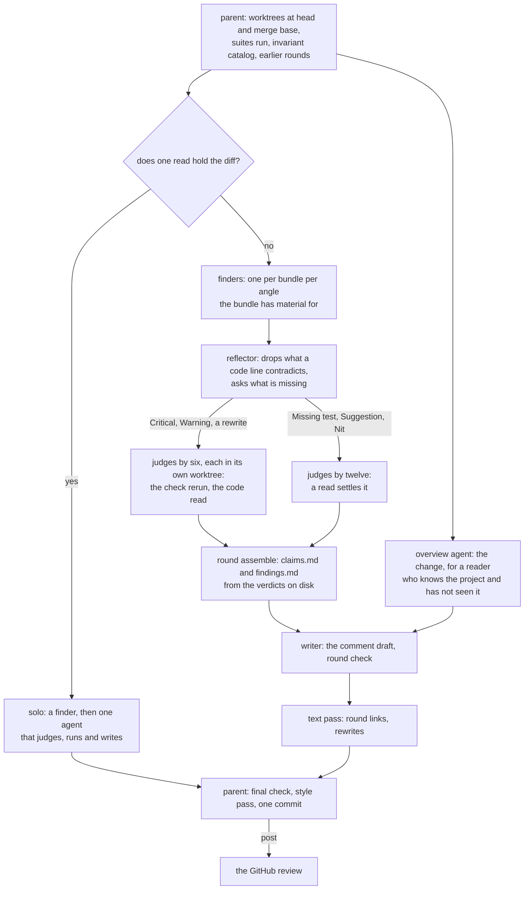

The instruction sets my coding agents load before they write anything on my
projects, and the tools that hold the agents to them. A skill is one Markdown
file per kind of artifact: a review, a pull request body, an issue, a commit, a
reply to me. The tools are a gate that records which skill an agent read, git
hooks that fire whatever tool or model made the commit, and a Rust crate
holding the lint over the rules and the steps a program does better than a
model.

The corpus is written for Claude Code and mounted as a `skills/` submodule in a
workspace. The workspace holds the consent rules, one rules file per
repository, the scripts the skills call and the review workflow, so the skills
run there and nowhere bare.

## TL;DR

```bash
# 1. Point git at the hooks, from a workspace that mounts this repository as skills/
git config core.hooksPath skills/scripts/git-hooks
git -C skills config core.hooksPath scripts/git-hooks
# 2. Print a skill and record the read
skills/scripts/skill review
# 3. Build the tools, then lint the rule files
cargo build --release --manifest-path skills/tools/Cargo.toml
skills/tools/target/release/rules lint AGENTS.md skills/*.md skills/pr-body/*.md skills/knowledge/*.md
# 4. Measure a chat reply
skills/scripts/reply-check.py <file>
# 5. Run every test
python3 -m unittest discover -s skills/scripts/tests
skills/scripts/tests/test_scrub.sh
cargo test --manifest-path skills/tools/Cargo.toml
# 6. Rebuild the site after editing this README
skills/scripts/site.py
```

## The idea

A rule matters at the moment an agent writes, and a rule it read an hour ago
is one it may skip. So every artifact has one skill, the skill goes into
context whole before the artifact's first line, and a command records that it
did. An agent writing or committing an artifact whose skill it never read gets
the skill's path and a warning, never a refusal. A repository's own rules
file, `projects/<repo>/AGENTS.md` in the workspace, wins over a skill where the
two disagree.

Four principles outrank every rule. They sit in the workspace's `AGENTS.md`,
since they bind whoever acts:

- Build what the task asks for and nothing speculative.
- Read the rule before writing the artifact.
- Measure, never assume: every claim about an artifact comes from a command run
  this session, never from memory.
- Read the artifact back after editing it, before reporting it done.

Nothing reaches anyone without my word, `post`, `push` or `merge`, typed in the
turn or given ahead for one repository and one kind of action. `go`, `ok` and
`yes` authorise nothing, and every draft is shown before it goes. Those rules
sit in the workspace's `AGENTS.md` too, and [`words.md`](https://github.com/davd-gzl/skills/blob/main/words.md) is
the one place a word is defined.

Every skill has a second goal beside its task: the same decision in fewer
turns. A turn re-sends the whole context, so the turn count times the context
is the cost, and output tokens are the minor term.

## The corpus stays flat

A model given many rules at once follows fewer of them: in one test of five
models, none followed all of 80, per
[`knowledge/rules-decay-past-eighty.md`](https://github.com/davd-gzl/skills/blob/main/knowledge/rules-decay-past-eighty.md).
A corpus that grows by one rule per mistake ends up enforcing none, so this one
grows only when I say so.

- [`scripts/rule-growth.py`](https://github.com/davd-gzl/skills/blob/main/scripts/rule-growth.py) refuses a commit that adds
  words to the rule files, at commit time and again at push, whatever model or
  command made it.
- The agent asks me first; my answer in the turn puts a `Grows: <why>` line on
  the commit, and the hook lets it through.
- A mistake a rule already forbids gets a check, a hook or a lint, never more
  words.

The rule files are the Markdown files at the root and under `pr-body/`, this
README and `TODO.md` aside; a workspace's own hook passes its own list.
[`authoring.md`](https://github.com/davd-gzl/skills/blob/main/authoring.md) holds where a rule lives, the shape it takes and
what it displaces.

## The skills

| File | Read when | Produces |
| --- | --- | --- |
| [`review.md`](https://github.com/davd-gzl/skills/blob/main/review.md) | a pull request, a branch, a working diff or a red CI is reviewed | the review round |
| [`review-modes.md`](https://github.com/davd-gzl/skills/blob/main/review-modes.md) | a run covers several targets, or I wrote the target | what that case changes in the round |
| [`review-comment.md`](https://github.com/davd-gzl/skills/blob/main/review-comment.md) | the review's comment draft is written or posted | the body, the inline-comment shape, the final check, posting |
| [`issue.md`](https://github.com/davd-gzl/skills/blob/main/issue.md) | a fix needs an upstream issue nobody has filed | `issue.md`, the problem and never the remedy |
| [`change.md`](https://github.com/davd-gzl/skills/blob/main/change.md) | an issue, a finding, or a docs or test-only change goes to a pull request | `spec.md` and `plan.md` with their open calls, the worktree, the fix, the local CI run, the pull request |
| [`pr-body.md`](https://github.com/davd-gzl/skills/blob/main/pr-body.md) | a change is proposed, before its pull request opens | the title and body, looped until a full pass changes nothing |
| [`pr-body/`](https://github.com/davd-gzl/skills/blob/main/pr-body) | `pr-body.md` has picked a shape | one body shape per file, each closing on a skeleton: [docs](https://github.com/davd-gzl/skills/blob/main/pr-body/docs.md), [one concern](https://github.com/davd-gzl/skills/blob/main/pr-body/one-concern.md), [several changes](https://github.com/davd-gzl/skills/blob/main/pr-body/several-changes.md), [a visible surface](https://github.com/davd-gzl/skills/blob/main/pr-body/surface.md) |
| [`try.md`](https://github.com/davd-gzl/skills/blob/main/try.md) | a project boots at a pull request, a branch or its default branch | a URL, a login and the click path to the change |
| [`report.md`](https://github.com/davd-gzl/skills/blob/main/report.md) | a periodic status report over several repositories | the report, written once I have edited its context |
| [`docs-site.md`](https://github.com/davd-gzl/skills/blob/main/docs-site.md) | a project's user-facing documentation site is written or reviewed | its home page, guides, FAQ and install pages, with their screenshots |
| [`project-background.md`](https://github.com/davd-gzl/skills/blob/main/project-background.md) | someone needs to know how a repository works without reading its code | a background doc pinned to one upstream commit, kept current |
| [`git.md`](https://github.com/davd-gzl/skills/blob/main/git.md) | a turn commits, pushes, syncs a checkout, or touches a submodule or worktree | the commit identity, where a push goes, the commands that report success and move nothing |
| [`writing-style.md`](https://github.com/davd-gzl/skills/blob/main/writing-style.md) | any visible prose, in any project | the rules every other skill defers to, and the closing pass over every draft |
| [`short-form.md`](https://github.com/davd-gzl/skills/blob/main/short-form.md) | every chat reply | the register: clipped, read once, left to right |
| [`reply.md`](https://github.com/davd-gzl/skills/blob/main/reply.md) | a reply finishes a piece of work | what it opens with, its closing block, its links |
| [`shortcuts.md`](https://github.com/davd-gzl/skills/blob/main/shortcuts.md) | every session | when a typed word counts: opening the message, whitespace between words |
| [`words.md`](https://github.com/davd-gzl/skills/blob/main/words.md) | I type a word | what each word starts, its row put in context when a message opens with it |
| [`thinking.md`](https://github.com/davd-gzl/skills/blob/main/thinking.md) | every reply, on a model whose thinking depth no setting controls | how the thinking before the reply is written |
| [`authoring.md`](https://github.com/davd-gzl/skills/blob/main/authoring.md) | a rule is added, edited or removed | where it lives, the shape it takes, what it displaces |
| [`knowledge/`](https://github.com/davd-gzl/skills/blob/main/knowledge) | a design question about the workflow comes up | one published result per file: what holds, the numbers, the source, the rule it shaped |
| [`knowledge/models/`](https://github.com/davd-gzl/skills/blob/main/knowledge/models) | a stage is sized for the model it runs on | one note per model: its limits and prices, and the effort per stage, inferred until a round measures it |
| [`archive/`](https://github.com/davd-gzl/skills/blob/main/archive) | nothing loads it | snapshots of a skill before a change of voice, the advisory shape for a disclosure, the harness that chose the chat register's wording |
| [`TODO.md`](https://github.com/davd-gzl/skills/blob/main/TODO.md) | skill work I own and have not started | one line per item |

Three files open every session: `shortcuts.md` and `thinking.md` through a
session-start hook, and `short-form.md` through the workspace's `CLAUDE.md`,
which every subagent inherits too, since its rules on what a claim must rest
on bind every agent. Every other skill is read when the task names it, through
the Read tool or `scripts/skill <name>`. A file whose sections fire at
different moments lists the ones its first reader needs on a `prompt-sections`
line, and the gate hands over that cut. A subagent gets the skills its own
artifact needs and no others.

## Models

One file binds only some models: [`thinking.md`](https://github.com/davd-gzl/skills/blob/main/thinking.md), how the
thinking before a reply is written, binds a model whose thinking depth no
setting controls. Its `effort-set`
frontmatter names the models the gate exempts; the gate reads the running
model from the harness's session-start payload or the transcript, and a model
it cannot name keeps the rules. [`knowledge/models/`](https://github.com/davd-gzl/skills/blob/main/knowledge/models) holds a
note per model a stage runs on, which the review reads to decide whether one
agent can hold a diff.

## The review

My work on a change starts as a review, of a pull request, a branch or a red
CI. [`review.md`](https://github.com/davd-gzl/skills/blob/main/review.md) drives it. The workspace runs it as one workflow
per target: a parent prepares and ships, and agents find, judge and write, each
reading only the rule sections its own output needs.

A finder reads one bundle, a group of changed files, for one angle, a kind of
defect to hunt. What it returns is a candidate, banded Critical, Warning,
Suggestion, Nit or Missing test. A judge reruns the candidate's check or reads
the code, and keeps it as a finding or refutes it.

| Word | For | What changes |
| --- | --- | --- |
| `quick review <target>` | code I know | a smaller finding budget per round, no reflector, smaller judge batches |
| `review <target>` | any change | the standard round |
| `deep review <target>` | code that is complex or unknown | finders with more tool calls, a higher Warning cap and the tests angle, smaller judge batches |

[`words.md`](https://github.com/davd-gzl/skills/blob/main/words.md) defines each word, and the workspace's `plan`
word prints a round's stages and projected cost for a given diff before
anything runs.

The word sets the most a round may run, and the change's class decides how
much of that it does. The parent names the class from its own read of the
diff, or a triage agent does:

| Class | The change | The round |
| --- | --- | --- |
| trivial | no behaviour change: a comment, a rename, a version bump | one agent finds, runs what it bands Warning, judges and writes |
| simple | one local behaviour change, one function and its direct callers | one finder per bundle carrying every angle, one judge batch, the writer |
| normal | a behaviour change with more than one reach, a new invariant, a guard removed | the word's shape |
| complex | a line one finder's reading cannot settle: a new mechanism, or two that interact | more tool calls per finder, the word's judge batches, the text pass |

A round, in the order [`review.md`](https://github.com/davd-gzl/skills/blob/main/review.md) runs it:

1. **Prepare.** Sync the checkout, open worktrees at the head and the merge
   base, read every comment and earlier round, and read each changed file whole
   with its callers. A branch from outside the project gets a static danger
   pass before it is fetched. The overview agent starts once the head worktree
   exists.
2. **Re-review gate and design.** Where an earlier round exists, a patch-id,
   git's hash of a diff, tells new code from a branch that only moved on its
   base, and a base-only move copies the old round forward. A first round asks
   whether the design is a good idea before any finder runs, and a doubtful
   one waits for a talk with me.
3. **Reproduce.** The project's own suites, once per tree state.
4. **Launch.** The plan prints, then the workflow runs the finders, the
   reflector, the judges, the writer and the text pass. A change fixing a
   reported vulnerability gets a critical pass bounded to that fix.
5. **Check.** The comment's final check, then the closing pass of
   [`writing-style.md`](https://github.com/davd-gzl/skills/blob/main/writing-style.md) over the overview and the draft.
6. **Critic read.** The finished round, read back against its own claims table.
7. **Commit.** One commit for the round; its push and the post go out as the
   workspace's consent rules say for that repository.
8. **Retro and handover.** What the round cost and found, then the draft for me
   to read.



The round on disk:

```text
projects/<repo>/reviews/<slug>/
  overview.md            the change, for a reader who knows the project and has not seen it
  <n>-<sha>/
    comment_<model>.md   the review as posted: the body, then one section per finding,
                         posted or SKIP, its repro collapsed
    claims.md            the record: every finding with its band, state and where the
                         draft put it, then each candidate with its check and output
    findings.md          the draft's skeleton, one block per anchored line in posting order
    links.md             every link of the draft and the overview, resolved at its sha
    check.md             the mechanical hits the writer cleared
    tests/               every artifact a judge ran
    candidates/          what each finder and the reflector returned, as JSON
    verdicts/            what each judge returned, as JSON
```

What a round carries in, beside the diff:

- **The invariant catalog**, `projects/<repo>/skills/invariant-catalog.md`: one
  class of defect per entry with the check that settles it, walked by the
  finders and extended by every confirmed finding of a class it lacked.
- **A target I wrote**: no draft and no posting; the round fixes what it finds
  and runs again until it stops finding, per
  [`review-modes.md`](https://github.com/davd-gzl/skills/blob/main/review-modes.md).

## Why each piece

Each decision, the reason for it and the evidence. Sources are from 2025 and
2026, since the field moves fast enough that older ones are not cited. A row
marked *measured* rests on this workspace's own rounds, and one marked *reason*
on the corpus's own argument until the outcome table measures it.

| Decision | Why | Evidence |
| --- | --- | --- |
| The finder runs its own Warning checks, and a judge reruns them | Reading is not verifying: a tool-running agent caught 95 % of the false positives in static-analysis warnings, against 36 % for a prompt alone. Over six rounds here, fresh verifiers rebuilding the finder's work refuted none of 52 Warnings | [Sifting the Noise 2026](https://arxiv.org/abs/2601.22952); *measured* |
| One judge per claim, in a fresh context, filing no finding of its own | Refuters holding the claim and none of the finder's reasoning killed 79 % of candidates; nine same-family judges carried 2.2 independent votes, and the best single judge beat the panel | [Refute-or-Promote 2026](https://arxiv.org/abs/2604.19049), [Nine Judges, Two Effective Votes 2026](https://arxiv.org/html/2605.29800) |
| Six candidates per judge where each needs its check rerun, twelve where a read settles each | A scoring judge lost 45 % of human agreement at two items, an auditor held to seven and fabricated at eight, and plain answer extraction held to fifteen | [BatchGEM 2026](https://arxiv.org/abs/2603.11009) |
| A Missing test or a Nit gets a read, never a rerun | A Missing test is an absence a grep settles; every Nit the verifiers refuted in two rounds was refuted by reading | *measured* |
| Finders at `xhigh`, every other stage at `high` | My call: on one round, finders at `xhigh` returned all six known Warnings and finders at `high` three, while `high` spent a sixth less output | *measured once* |
| Code before the description, and five angles read the code with its comments blanked | "Bug-free" framing on vulnerable code cut detection by 16.2 to 93.5 points across six models, and a doc comment calling something safe is the same framing inside the code | [Mitropoulos et al. 2026](https://arxiv.org/abs/2603.18740); *reason* for the comments |
| One reflector, before the judges | It reads every candidate once against the diff, drops what a code line contradicts, and asks what is missing, the question a critic agent running beside the judges used to ask at three times the cost | *measured: 5 of 75 dropped, 3 added* |
| An angle runs only where the diff has material for it | An angle with nothing to walk costs a full read and returns nothing | *reason* |
| A tool-call budget per judge | One verifier ran 42 minutes and held four stages behind it; the budget ends it unsettled with the check named | *measured* |
| The invariant catalog, walked and extended each round | A confirmed class the catalog lacked is the class the next round misses | *reason* |
| The re-review gate, by patch-id | Nobody re-reviews code that did not change | *reason* |
| An outcome table per posted round, recording which threads the authors resolved | Every number above comes from someone else's task; what the authors resolved tunes the next batch size, cap and effort | [When Auditors Fabricate 2026](https://arxiv.org/abs/2609.09696); *reason* |
| Not yet: a refuter from another model family | A cross-family refuter caught 16 % of the misses a same-family one let through, and every stage here runs one family | [Refute-or-Promote 2026](https://arxiv.org/abs/2604.19049) |

## What enforces it

### The read gate

[`scripts/skill-gate.py`](https://github.com/davd-gzl/skills/blob/main/scripts/skill-gate.py) records every read of a skill,
by the Read tool or by [`scripts/skill`](https://github.com/davd-gzl/skills/blob/main/scripts/skill): `scripts/skill review`
for a skill, `scripts/skill pr-body/docs` for a body shape, `scripts/skill
<project>` for a project's own rules file. Before a write, it puts the skills
that write still lacks into context with a warning, names each by path, and
lets the write through. A read holds while the file's hash matches and the
session is the same; a stale read prints only the diff since it was made.

The same hook refuses the few commands that cannot be taken back without my
word: a publish the turn carries no word for, a sync that resets a remote
branch, an AI-authorship marker in a message, a commit identity set by hand.

In Claude Code, the workspace's settings file wires it: the before-write hook
on `Write|Edit|MultiEdit|Bash` calls `skill-gate.py hook-claude`, the hook
before `Read` calls `hook-read` to record the read, the session-start hook calls
`session-start`, and the prompt hook `prompt`. Another harness runs
`skill-gate.py check <path>` before writing and exports its session id as
`CLAUDE_CODE_SESSION_ID`.

### The git hooks

[`scripts/git-hooks/`](https://github.com/davd-gzl/skills/blob/main/scripts/git-hooks) holds them, and they run whatever
made the commit, any model or none:

| Hook | Does |
| --- | --- |
| `pre-commit`, `pre-merge-commit` | warns on a commit carrying an artifact whose skill was not read; refuses one recording a submodule commit no remote holds, or a workflow script that does not parse; `pre-commit` also refuses a change to this README or a blog post that leaves the site behind |
| `commit-msg` | refuses a commit adding words to the rule files with no `Grows:` line giving a reason |
| `pre-push` | refuses a pushed line or message carrying a secret shape or a name the workspace's `workspace.json` lists, through [`scrub.sh`](https://github.com/davd-gzl/skills/blob/main/scripts/scrub.sh); refuses a pushed commit that grew the rules with no reason, one made by `--no-verify`, a rebase or a cherry-pick included; warns as `pre-commit` does |

### The lint

[`rules lint`](https://github.com/davd-gzl/skills/blob/main/tools/src/lint) warns and never blocks: a rule telling the
reader to stop measuring, a date or a sha inside a rule, an em-dash or a
parenthetical in prose, a capability asserted without the command that reads
it, a pointer at a file or a section that does not exist, one rule stated in
two files. It closes on a health table per file: the word count, the words per
rule, the negation density and the share of bullets in bold.

### The reply check

Every chat reply takes [`short-form.md`](https://github.com/davd-gzl/skills/blob/main/short-form.md). Its wording won a
blind comparison, kept in [`archive/chat-register/`](https://github.com/davd-gzl/skills/blob/main/archive/chat-register):
several candidate wordings, no rule at all and the caveman plugin each answered
that plugin's own prompts, and a judge who could not see which was which
ranked the answers.

[`scripts/reply-check.py`](https://github.com/davd-gzl/skills/blob/main/scripts/reply-check.py) measures a reply or a
transcript after the fact. It prints the words, the articles per hundred and
the words per sentence, none of them a fault, and flags the faults: a hedge, a
pleasantry, a path named with no link, a one-letter shortcut the reply made up
without defining it. No hook calls it, since a writer shown a number writes to
move the number.

## The scripts and tools

| Path | Does |
| --- | --- |
| [`scripts/skill`](https://github.com/davd-gzl/skills/blob/main/scripts/skill) | prints a skill or a project's own rules file and records the read |
| [`scripts/skill-gate.py`](https://github.com/davd-gzl/skills/blob/main/scripts/skill-gate.py) | the read gate and its hooks |
| [`scripts/sections.py`](https://github.com/davd-gzl/skills/blob/main/scripts/sections.py) | cuts one `path#Heading` section out of a rule file; `check` lists every section name a pipeline config or a `prompt-sections` line gives that matches no heading or matches two |
| [`scripts/rule-growth.py`](https://github.com/davd-gzl/skills/blob/main/scripts/rule-growth.py) | the growth check behind `commit-msg` and `pre-push` |
| [`scripts/scrub.sh`](https://github.com/davd-gzl/skills/blob/main/scripts/scrub.sh) | the secret and private-name scan behind `pre-push`; `--tree` reads the whole tree |
| [`scripts/snapshot`](https://github.com/davd-gzl/skills/blob/main/scripts/snapshot) | commits a worktree's uncommitted build over its HEAD without moving a branch and prints the sha, so a round reviews a build before anything is committed |
| [`scripts/reply-check.py`](https://github.com/davd-gzl/skills/blob/main/scripts/reply-check.py) | measures a chat reply or a transcript |
| [`scripts/site.py`](https://github.com/davd-gzl/skills/blob/main/scripts/site.py) | builds the site under `docs/` |
| [`scripts/tests/`](https://github.com/davd-gzl/skills/blob/main/scripts/tests) | the tests of the gate, the reply check, the growth check, the scrub and the snapshot |
| [`tools/`](https://github.com/davd-gzl/skills/blob/main/tools) | one Rust crate, two binaries: `round`, a review round's fixed steps, from resolving every link at its sha to writing `claims.md` from the verdicts, and `rules lint`; [`tools/README.md`](https://github.com/davd-gzl/skills/blob/main/tools/README.md) holds the contract |

## The site

[davd-gzl.github.io/skills](https://davd-gzl.github.io/skills/) serves this
README and the posts under [`knowledge/blog/`](https://github.com/davd-gzl/skills/blob/main/knowledge/blog).
[`scripts/site.py`](https://github.com/davd-gzl/skills/blob/main/scripts/site.py) builds them into `docs/`, each relative
link rewritten to its GitHub URL, and `--check` exits 1 when `docs/` lags its
sources, which `pre-commit` runs on every commit touching them.
